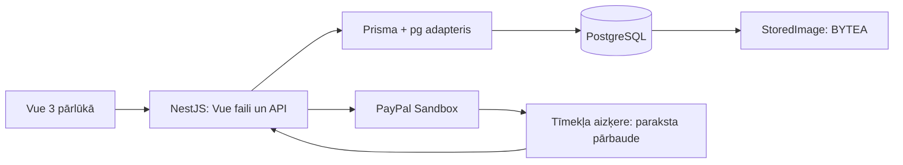

# Arhitektūra

Saknes Dockerfile būvē frontend un backend un palaiž vienu NestJS procesu.
Tas izsniedz Vue statiskos failus, klienta maršrutu sākumlapu un API ar `/api`
prefiksu. Izstrādē Vite darbojas atsevišķi un pārsūta `/api` uz NestJS.

Backend ir neliels monolīts. Kontrolieris savieno HTTP pieprasījumus ar Prisma
un maksājumu servisiem. Piekļuves noteikumi un PayPal stāvokļa pārveidošana
izdalīti tīrās funkcijās neatkarīgai testēšanai. Paplašinot sistēmu, kontrolieri
var sadalīt moduļos auth, cats, posts un subscriptions.

Lietotājs var būt savu kaķu īpašnieks un abonēt citu kaķu saturu.
Atsevišķas CREATOR lomas nav: īpašumtiesības nosaka `Cat.ownerId`. ADMIN var
moderēt publikācijas ar API. Administratoru izveido sākotnējo datu skripts,
bet publiskā reģistrācija vienmēr piešķir lomu USER.

Privātai publikācijai bez piekļuves atgriež tikai virsrakstu, datumu un bloķēšanas
pazīmi. Tekstu, faila atslēgu un attēla URL neatklāj. Failus neizsniedz statiski:
katrs attēla GET atkārtoti pārbauda tiesības un nosūta `private, no-store`.
Augšupielādēto attēlu dekodē un pārkodē JPEG formātā bez sākotnējiem metadatiem.

JWT glabājas HttpOnly sīkdatnē; noklusējuma politika ir SameSite=Lax.
HTTPS gadījumā izmanto Secure. Dažādām vietnēm var iestatīt SameSite=None kopā
ar Secure. CORS un datus mainošo pieprasījumu Origin pārbaude izmanto vienu
atļauto izcelsmju sarakstu. Tiek pārbaudīti DTO tipi un objektu īpašumtiesības.
Paroles jauc ar bcrypt. JWT, PayPal noslēpumi un lokālie .env faili nav iekļauti Git.

Galvenās tabulas: User → Cat → Post; User → Subscription ← Cat; WebhookEvent.
OwnerPayment saglabā unikālus PayPal maksājumus, WithdrawalRequest — rezervētus
izmaksu pieprasījumus bez īstas naudas pārskaitīšanas, LoginEvent — veiksmīgo
pieteikšanos metadatus. Vēstures maršruti atlasa tikai pašreizējā lietotāja datus.
Pāris userId/catId un paypalId ir unikāli. paidUntil ierobežo piekļuvi arī tad,
ja paziņojums par abonementa beigām nav saņemts. Atcelšana uzreiz pārtrauc piekļuvi.

PostgreSQL glabā lietotāju datus un fotoattēlus tabulā `StoredImage` (BYTEA).
Datubāzes savienojumu norāda `DATABASE_URL`; Compose saglabā to sējumā `postgres_data`.
`API_URL` nonāk Vue klientā ar `/runtime-config.js`; publiskajā konfigurācijā
netiek iekļauti servera noslēpumi.
