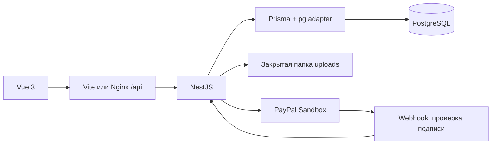

# Архитектура

Backend — небольшой монолит. Контроллер связывает HTTP-запросы с Prisma и
сервисами оплаты; правила доступа и преобразование состояния PayPal выделены
в чистые функции для независимой проверки. При расширении контроллер можно
разделить на модули auth, cats, posts и subscriptions.

Пользователь может одновременно владеть котами и подписываться на чужих.
Отдельной роли CREATOR нет: владение определяется `Cat.ownerId`. ADMIN может
модерировать публикации через API. Администратор создаётся seed, публичная
регистрация всегда назначает USER.

Приватная публикация возвращает только заголовок, дату и признак блокировки.
Текст, ключ файла и URL картинки не выдаются. Файлы не раздаются статически:
каждый GET картинки повторно проверяет права и отправляет `private, no-store`.
Загруженное изображение декодируется и перекодируется в JPEG без исходных метаданных.

JWT хранится в HttpOnly cookie, SameSite=Lax. Для HTTPS используется Secure.
Проверяются Origin у изменяющих запросов, типы DTO и владение объектами.
Пароли хешируются bcrypt. JWT, PayPal secret и локальные .env исключены из Git.

Основные таблицы: User → Cat → Post; User → Subscription ← Cat; WebhookEvent.
Пара userId/catId и paypalId уникальны. paidUntil ограничивает доступ даже при
потерянном уведомлении об истечении подписки. При отмене доступ прекращается сразу.
